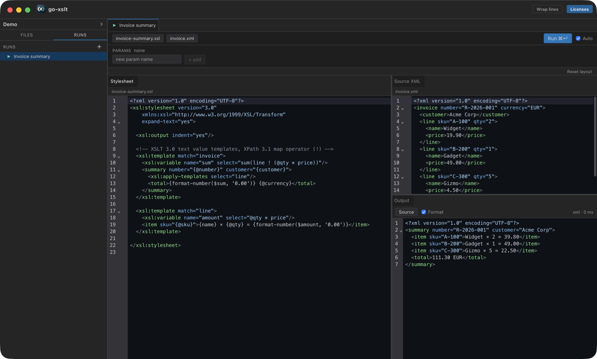

<p align="center">
  
</p>

<h1 align="center">go-xslt</h1>

<p align="center">
  XSLT 3.0, XPath 3.1 and XSD 1.0 / 1.1 in pure Go.<br>
  <sub>by Tim Riep</sub>
</p>

<p align="center">
  <a href="https://tim-riep.github.io/go-xslt/"><b>Documentation</b></a>
</p>

## Why go-xslt?

A **pure-Go** implementation of the W3C XML processing stack:

- **XSLT 3.0** transformations, **XPath 3.1** evaluation, **XSD 1.0 / 1.1**
  validation — one engine, built from scratch
- no libxslt, no libxml2, no CGo (for the library), no JRE
- one dependency (`golang.org/x/text`) — `go get` and import, nothing to install
- embeddable as an ordinary Go package, not just a CLI
- development driven by the official **W3C conformance test suites**
  (~99% pass across all three), not hand-picked examples — see
  [Conformance benchmarks](#conformance-benchmarks)

The repo also ships an optional desktop **XSLT/XSD/XPath tester** (Wails v3 +
React + CodeMirror) built on the same engine.

<p align="center">
  
  <br>
  <sub>The desktop tester: stylesheet, source and live output. Drag a pane's tab to dock it anywhere.</sub>
</p>

The repo is a monorepo of **two Go modules**:

| Module | Import path | Deps | Use it for |
|--------|-------------|------|------------|
| **library** (root) | `github.com/tim-riep/go-xslt` | `golang.org/x/text` only | Embedding the engine in your own Go code |
| **desktop** (`desktop/`) | `github.com/tim-riep/go-xslt/desktop` | Wails v3 + the library | The GUI tester app |

Importing the library never pulls in Wails or any GUI/CGo dependency.

## What's in the library

- A **highly conformant XSLT 3.0 transformation engine**: templates/modes/priority matching,
  `apply-templates`/`next-match`/`apply-imports`, tunnel parameters,
  `for-each-group` (all four groupings), `iterate`, `try`/`catch`, `evaluate`,
  `merge`, `accumulator`, `result-document` (multiple outputs), `key`/`function`,
  `character-map`, `decimal-format`, attribute sets, text value templates, and
  the full XML/HTML/text/JSON-adjacent serialization parameter set — see
  [XSLT engine status](#xslt-30-engine) below for the complete instruction list.
- A **highly conformant XPath 3.1 implementation**: the full operator/
  precedence chain, a typed XSD atomic value system (arbitrary-precision
  integer/decimal, date/time/duration, binary, QName, anyURI, …), sequences,
  maps and arrays with `?` lookup, inline/named/partially-applied functions,
  and the ~145-function Functions & Operators 3.1 catalog.
- A **from-scratch XML Schema (XSD) 1.0 and 1.1 validator**: full facet-based
  simple types, complex content models (sequence/choice/all, wildcards,
  substitution groups, extension/restriction), identity constraints (key/
  keyref/unique), XSD 1.1 assertions and conditional type assignment,
  `xs:override`/`xs:redefine`, and an XSD-aware regex-grammar validator.
- A **from-scratch XML node tree** (`internal/xmltree`): its own parser (on
  `encoding/xml`), document order, line/col tracking for diagnostics, and a
  serializer driving XML/HTML/text output.
- Every entry point is **panic-safe**: compile/parse/runtime failures come
  back as diagnostics with W3C error codes, line/col, and phase — never as an
  uncaught panic.

## Conformance benchmarks

Measured against the official W3C test suites (`test/conformance/`; see
`CLAUDE.md` for full per-milestone history). Numbers below are of
**applicable** cases — each harness runs every case whose declared spec/
feature dependencies this engine's declared identity actually satisfies, and
skips the rest (e.g. an XQuery-only case, against a processor that
implements XPath/XSLT but not XQuery); that skip is reported separately and
never counted toward the pass rate. **"Suite self-contradiction"** means two
suite fixtures assert mutually exclusive expected output for materially the
same input — confirmed by running the disputed case through a live,
independent reference processor (SaxonJS), not assumed — rather than an
engine gap; see `CLAUDE.md` for the specific cases.

Measured 2026-10-11 on engine commit [`35ffebc`](https://github.com/tim-riep/go-xslt/commit/35ffebc) (release `v0.0.6`), against these suite commits:

| Suite | Source | Commit | Pass rate | Detail |
|---|---|---|---|---|
| **XSLT 3.0** — default (basic) processor | [w3c/xslt30-test](https://github.com/w3c/xslt30-test) | `fddf1cf9` (2026-06-10) | **99.9%** (8,126 / 8,138) | by min spec version: 1.0 **100.0%** (1,980/1,980), 2.0 **99.8%** (2,656/2,660), 3.0 **99.8%** (3,485/3,493) |
| **XSLT 3.0** — combined (`XSLT30_FULL=1`: + streaming + schema-awareness + XSLT 1.0 backwards-compatible processing, see [below](#xslt-30-engine)) | same | same | **99.7%** (11,779 / 11,808) | |
| **XPath 3.1 / XQuery F&O** (QT3/FOTS) | [w3c/qt3tests](https://github.com/w3c/qt3tests) | `201a6e46` (2026-05-14) | **99.8%** (22,099 / 22,153) | |
| **XSD 1.0** | [w3c/xsdtests](https://github.com/w3c/xsdtests) | `7bc3365c` (2026-04-01) | **99.99%** (39,346 / 39,351) | 5 residual are suite self-contradictions |
| **XSD 1.1** | same | same | **99.99%** (41,499 / 41,503) | 4 residual are suite self-contradictions |

The residual XSLT/XPath gaps are concentrated in genuinely hard or
out-of-scope territory: JSON pretty-printing (implementation-defined, no
conformance test requires it — the `json`/`adaptive` output methods
themselves are fully implemented), broad `xsl:source-document` static
enforcement beyond the spec's own guaranteed-streamability minimum (measured
net-negative every time it's been tried), UCA `reorder=` script-group
tailoring, XQuery module loading, the XPath static typing feature, a live
network-dependent assertion or two, and a short tail of environment-specific or individually-documented
suite fixture artifacts. (Regex back-references are no longer a gap: a
dedicated backtracking matcher handles them when RE2 can't, used only for
patterns that actually need it.)

**Every failing case is listed with its reason** in
[`docs/accepted-failures/`](docs/accepted-failures/README.md) (one file per
suite). The harnesses enforce it: an undocumented failure fails the test.

**Reproducing these numbers**: `go test ./test/conformance/...` — the suites
above are third-party, gitignored, and not vendored, so a fresh clone of
*this* repo builds and tests green without them; the conformance tests
simply skip when a suite clone is absent. See
[`test/conformance/README.md`](test/conformance/README.md) for the exact
clone command per suite and every `go test` environment-variable knob
(per-suite triage/progress output, the `XSLT30_FULL=1`/`XSLT30_BYVER=1`
flags, etc.). The suites are living repos, so cloning current `HEAD` of each
(rather than the pinned commit above) will usually reproduce the same
numbers within a case or two, not necessarily exactly.

## Use as a library

Requires **Go 1.25+**. **Pre-1.0**: the public API (`engine/`), the desktop
app's on-disk project format, and large parts of the internal architecture
are still expected to change without notice — see
[CONTRIBUTING.md](CONTRIBUTING.md).

```bash
go get github.com/tim-riep/go-xslt
```

```go
package main

import (
	"fmt"

	"github.com/tim-riep/go-xslt/engine"
)

func main() {
	res := engine.Transform(engine.Request{
		Stylesheet: `<xsl:stylesheet version="3.0" xmlns:xsl="http://www.w3.org/1999/XSL/Transform">
		  <xsl:template match="/"><xsl:copy-of select="."/></xsl:template>
		</xsl:stylesheet>`,
		Source: `<a><b>x</b></a>`,
	})
	if res.HasErrors() {
		fmt.Println("errors:", res.Diagnostics)
		return
	}
	fmt.Println(res.Output)
}
```

`engine.Transform` is panic-safe: compile/parse/runtime failures come back as
`res.Diagnostics` (with W3C error codes, line/col, and phase), never as panics.
`Request` also supports `Params`, `InitialTemplate`, `BaseDir` (for
`xsl:import`/`document()`/`unparsed-text()`/`xsl:result-document`) and
`Security` (which files and network resources a run may read, see
[Security](#security)); `Result` carries `Output`, `Diagnostics`, `Messages`,
and `SecondaryOutputs`.

### Compile once, run many times

`engine.Transform` compiles the stylesheet on every call. To run the same
stylesheet against changing data (a live preview, a service), compile it once:

```go
sheet, diags := engine.Compile(engine.Request{Stylesheet: src, BaseDir: dir})
if sheet == nil {
	// diags[0].Line / .Col point into the stylesheet
}
res := sheet.Transform(engine.TransformRequest{Source: xml, Params: params})
```

A `*engine.Stylesheet` is immutable and **safe for concurrent use** (every run
builds its own state; there is a `-race` test for it). `Transform`,
`TransformTo(io.Writer, …)` and `TransformFromReader(io.Reader, …)` mirror the
package-level functions. A failure carries the W3C error `Code` and, for a
runtime error, the `Line`/`Col` of the stylesheet instruction it arose in, so a
host that *generates* the stylesheet can map it back to its own source.

### Reading a schema: `xsd`

Package `github.com/tim-riep/go-xslt/xsd` is a read-only view of a compiled
XSD 1.0/1.1 schema — useful for checking, without an instance document, that a
path exists, has the right type, and has the right cardinality:

```go
schema, diags := xsd.Compile(xsd.Request{Schemas: docs, BaseDir: dir, Version: xsd.V10})

for _, el := range schema.GlobalElements() {
	if ct, ok := el.Type().(*xsd.ComplexType); ok {
		for _, p := range ct.ContentParticles() {
			// p.MinOccurs, p.MaxOccurs (xsd.Unbounded = -1), p.Term: *xsd.Element,
			// *xsd.ModelGroup (sequence/choice/all) or *xsd.Wildcard
		}
		for _, a := range ct.Attributes() { /* a.Name, a.Type, a.Use */ }
	}
}
td := schema.Type(xml.Name{Space: ns, Local: "Money"})
td.IsSimple(); td.BuiltinBase() // {xs}decimal, through restriction chains
```

`xs:import`/`include`/`redefine`/`override` across files resolve against
`BaseDir`; `schema.SubstitutionMembers(head)` lists a substitution group
transitively. Content models and attributes are the *effective* ones (after
extension/restriction). A `*xsd.Schema` is immutable and safe for concurrent
use; `schema.Unresolved()` lists references to types the schema never defines
(`Compile` also reports them as warnings).

`engine/` is a thin re-export of the stable `internal/engine` facade —
everything behind it can evolve without breaking callers.

```bash
go test ./...        # engine unit tests + conformance harnesses (skip if suites absent)
```

## Security

Stylesheets, XPath expressions, schemas and source documents can name other
resources: `xsl:import`, `document()`, `fn:unparsed-text`, `xs:import`, a
`DOCTYPE`'s external subset. When that input is not trusted, unrestricted
access would let it read any file the process can read and copy it into the
output, or make requests to internal services. go-xslt therefore limits all of
it by default. Only the calling program can widen the limits, never the
input. The settings are in `Security`, a field of `engine.Request`,
`engine.TransformRequest`, `engine.XPathRequest`, `engine.ValidateRequest`
and `xsd.Request`.

| | Default | Opt-in |
|---|---|---|
| **Local files** | Only files under `BaseDir` (and its subdirectories). Without `BaseDir`, no file is read at all. | `AllowedDirs: []string{…}` adds directories; `AllowAllFiles: true` lifts the limit. |
| **Network** (`http`, `https`) | Off. Such a URI is an unavailable resource. | `AllowNetwork: true`; `AllowedHosts` restricts it to host names (a leading `.` includes subdomains). |

```go
res := engine.Transform(engine.Request{
	Stylesheet: src,
	BaseDir:    "/srv/jobs/42",
	Security: engine.Security{
		AllowedDirs:  []string{"/srv/shared/schemas"},
		AllowNetwork: true,
		AllowedHosts: []string{"data.example.com"},
	},
})
```

**Local files.** The rule covers every read:
- stylesheet modules (`xsl:import`, `xsl:include`)
- `xsl:import-schema`, and the schema documents of `xs:include`,
  `xs:import`, `xs:redefine`, `xs:override` and `xsi:schemaLocation`
- `document()`, `fn:doc`, `fn:unparsed-text*`, collections and
  `xsl:source-document`
- static evaluation in `use-when`
- the stylesheet a nested `fn:transform` loads
- the external DTD subsets and entity files that any of these documents pull
  in

Symbolic links are resolved before the check, so a link inside `BaseDir` that
points outside it is refused. A refused file looks to the stylesheet like a
missing one: `doc-available()` returns false, and `fn:unparsed-text` raises
FOUT1170. go-xslt never writes files; `xsl:result-document` output comes back
in `Result.SecondaryOutputs`.

**Network.** Redirects are checked against `AllowedHosts` too. Each response
is limited to 64 MB and 30 seconds, and URLs with a user name or password are
refused. Within one run every URI is fetched once and the answer reused, as
F&O requires for `fn:doc` and `fn:unparsed-text`. A document fetched over the
network is parsed without reading any external DTD or entity file, so a
remote `DOCTYPE` cannot pull in local files. Not yet covered by `AllowNetwork`:
`xsl:import`, `xsl:import-schema` and `xs:import` locations always stay local.

**Desktop tester.** Each run may read the files of its own project folder.
Network access stays off.

**Upgrading:** before this option existed, absolute paths and paths outside
`BaseDir` were read without restriction. A program that relies on that sets
`AllowedDirs`, or `AllowAllFiles: true` for input it trusts.

## Desktop tester (GUI)

The GUI is the separate `desktop/` module. **Run its commands from `desktop/`.**

Requirements: Go 1.25+, Node 20+/npm, and the
[Wails v3 CLI](https://v3.wails.io)
(`go install github.com/wailsapp/wails/v3/cmd/wails3@latest`).

```bash
cd desktop

make dev            # live dev (Vite HMR + Go) — or: wails3 dev
make build          # native build for the host OS
make build-win      # cross-compile Windows exe, x64 + ARM64 (pure Go, no CGo)
make build-mac      # macOS builds, Apple Silicon + Intel (native CGo/webkit)
make build-linux    # cross-compile Linux x64 via Docker (needs `make setup-docker` once)
make build-all      # every platform above in one go
make bindings       # regenerate TS bindings after changing a Go service
```

Output lands in `desktop/build/bin/`, one per target: a bare executable for
Windows/Linux (`go-xslt-windows-amd64.exe`, `go-xslt-linux-amd64`), a real,
ad-hoc-signed `.app` bundle for macOS (`go-xslt-darwin-arm64.app`) — since
macOS won't launch a bare CLI-style binary via Finder/double-click. An
ad-hoc-signed (not notarized — that needs a paid Apple Developer account)
app downloaded from the internet still gets one Gatekeeper prompt on first
launch; right-click → Open (or System Settings → Privacy & Security → Open
Anyway) past it once. GUI features: three modes — an
**XSLT** tester (CodeMirror 6 editor with XSLT/XML highlighting, a lint gutter
wired to engine diagnostics, stylesheet parameters, and secondary/message
output panes), an **XSD** validator (schema + instance panes, pass/fail with
located diagnostics), and an **XPath** evaluator (expression input with a
typed result table for sequences/maps/arrays) — plus workspaces (a folder +
`goxslt.workspace.json` manifest holding the stylesheet, source XML, and
parameters, with a remembered recent list).

## Architecture

```
engine/                       public facade: engine.Transform(Request) Result
internal/engine               stable internal facade (the engine/ re-export target)
internal/xmltree              XML parser + node tree + serializer (xml/html/text)
internal/xpath                XPath: lexer, parser, evaluator, functions, patterns
internal/xslt                 stylesheet compiler + transformation engine
internal/xsd                  XSD 1.0/1.1 schema validator
test/conformance/             W3C QT3 (XPath) + XSLT 3.0 + XSD conformance harnesses
desktop/  (separate module)
  main.go / xsltservice.go    Wails app + service (RunTransform, workspace ops)
  internal/workspace          workspace manifest load/save + recent list
  frontend/                   React + Vite + CodeMirror UI
```

Everything depends only on the engine facade; whatever is behind it can evolve
without breaking callers.

## XPath 3.1

The engine implements the full XPath 3.1 **language** (per the W3C grammar):
the complete operator set and precedence (value/general/node comparisons,
`||`, `intersect`/`except`, `instance of`/`treat`/`castable`/`cast`, arrow `=>`,
simple map `!`, range `to`, `for`/`let`/`some`/`every`/`if`), a **typed XSD
atomic value system** (numeric tower with arbitrary-precision integer/decimal,
date/time/duration, binary, anyURI, QName, untypedAtomic) with casting and
atomization, maps/arrays with the `?` lookup operator, inline functions, named
function references (`f#1`), partial application (`f(?, x)`), comments `(: :)`,
and `Q{uri}local` names. The Functions & Operators 3.1 catalog (~145 functions:
string/regex, numeric, date/time, sequence, node, URI, QName, higher-order,
map, array, JSON) is implemented on the Go standard library.

## XSLT 3.0 engine

By default, the engine runs as a highly conformant XSLT 3.0 **basic
processor** — 99.9% of the W3C suite, see
[Conformance benchmarks](#conformance-benchmarks). Three of the spec's
optional, heavyweight conformance features are also implemented (each is a
substantial capability in its own right, not a stub), but stay **off by
default**, one claim switch each, so a caller opts in explicitly to exactly
what it needs:

- **Core**: `template` (match + named), modes (incl. `xsl:mode`/`on-no-match`),
  priority-based matching, built-in template rules, `apply-templates`,
  `next-match`, `apply-imports`, tunnel parameters, import precedence via
  `xsl:import`/`xsl:include`, `value-of`, `for-each`, `if`, `choose`,
  `variable`/`param`/`with-param`, `call-template`, `attribute`, `element`,
  `copy`/`copy-of` (incl. XSLT 3.0 `copy/@select`), `text`, `comment`,
  `processing-instruction`, `sort`, attribute value templates, and `output`
  (xml/html/text/**json**/**adaptive**) with the full serialization-parameter
  set (indent, CDATA sections, doctype, character maps, normalization form,
  byte-order mark, `json-node-output-method`, `build-tree`,
  `allow-duplicate-names`, …).
- **XSLT 3.0 instructions**: `for-each-group` (all four groupings +
  `current-group()`/`current-grouping-key()`, typed/collation-aware key
  comparison), `perform-sort`; `iterate`/`next-iteration`/`break`/
  `on-completion`; `try`/`catch`; `evaluate`; `merge` (multi-source, typed
  merge keys, `current-merge-group()`/`current-merge-key()`); `number`;
  `message`/`assert`; `result-document` (multiple secondary outputs, each with
  its own serialization parameters, incl. `json`/`adaptive`); `map`/
  `map-entry`; `namespace`; `namespace-alias`; `document`; `attribute-set` +
  `use-attribute-sets`; `where-populated`; **text value templates**
  (`expand-text="yes"`); `key`/`key()` (composite keys, collation-aware);
  `function` (arity-based overloading, `new-each-time`/`cache` memoization);
  `sequence`; `analyze-string`; `accumulator`; `character-map`;
  `decimal-format`; `context-item`; `fork` (its non-streaming
  `xsl:sequence`+ content shape — the one shape XSLT actually defines
  independently of streaming); **`use-package`** (library packages with
  visibility/exposure rules — a stand-alone `xsl:package` with no
  `xsl:use-package` still runs like an ordinary stylesheet).
- **Static compilation**: static parameters (`xsl:param static="yes"`,
  cross-module resolution with import precedence), shadow attributes
  (`_name="{…}"`), and `use-when` conditional inclusion.
- **XDM sequence model (XPath 3.1)**: full operator set, typed atomics, maps,
  arrays, higher-order functions, ~145 F&O functions (see XPath 3.1 above).
- **True, bounded-memory streaming** (`xsl:source-document`, streamable
  `xsl:mode`/`xsl:function`/attribute-sets, `xsl:fork`'s streaming content
  shape): a real incremental XML reader plus a compile-time posture/sweep
  classifier (XSLT 3.0 §19/Appendix J) that only ever approves a construct
  it can *prove* safe, raising a clear `XTSE3430`-class diagnostic instead
  of ever silently mis-executing. The memory bound is measured, not
  asserted: ~2 MB peak heap across a 2–82 MB input document vs. ~630 MB
  buffered (313×) — see `engine.TransformTo` for the output-side equivalent.
  99.6% of the suite's streaming-specific cases pass.
- **Schema-awareness** (`xsl:import-schema`, real `[xsl:]validation`/
  `[xsl:]type` dispatch, typed input, `element(N,T)`/`schema-element(N)`):
  a runtime-only schema-aware processor per XSLT 3.0 §26.2's own exact,
  closed definition of the term — dynamic `XTTE`-class errors on a
  validation failure, no compile-time type provability. (§26.1 explicitly
  leaves XPath's *optional* Static Typing Feature's interaction with XSLT
  unspecified and required by no conformance level, so that one narrower
  piece stays out of scope.) 99.8% of the suite's schema-aware-specific
  cases pass.
- **XSLT 1.0 / pre-2.0 backwards-compatible processing** (an
  `[xsl:]version` below 2.0 anywhere in scope, XSLT 3.0 §3.9.1): real,
  per-element-scoped 1.0 comparison/arithmetic/conversion leniency, not a
  flat rejection.

A real embedding caller turns on exactly the feature(s) it needs
(`internal/xslt/*_property.go`'s `SetSchemaAware`/`SetBackwardsCompatible`/
streaming's own strict-enforcement flag) rather than an all-or-nothing
switch; the conformance harness's `XSLT30_FULL=1` claims all three together
for measurement purposes (see [Conformance benchmarks](#conformance-benchmarks)).

## XSD 1.0 / 1.1 validation

A from-scratch XML Schema validator (`internal/xsd`), exposed via the public API:

```go
res := engine.Validate(engine.ValidateRequest{
    Schemas:  []string{schemaXSD},
    Instance: instanceXML,
    Version:  engine.XSD11, // or engine.XSD10 (default)
})
// res.Valid, res.Diagnostics — each diagnostic carries a spec/component-
// constraint code and a source line/col (schema-compile errors excepted).
```

Covers simple types (full facets, incl. the built-in list types), complex
content models (sequence/choice/all, wildcards, substitution groups,
extension/restriction, Unique Particle Attribution and Particle-Valid-
Restriction checking), identity constraints (`key`/`keyref`/`unique`),
multi-document `import`/`include`/`redefine`/`override`, and the XSD 1.1
additions (`assert`, conditional type assignment, `openContent`,
`explicitTimezone`, negated wildcards, …), plus a structural "schema for
schemas" validator that rejects malformed schema documents themselves.
Validated against the official **W3C XML Schema Test Suite** (`xsdtests`, ~80k
verdicts across both versions) via `test/conformance/xsd_test.go` — **99.99%
of applicable cases pass in both 1.0 and 1.1** (see
[Conformance benchmarks](#conformance-benchmarks)); the handful of residual
fails are documented suite self-contradictions, not engine gaps. `Compile`/
`Validate` return `ErrUnsupported` (not a verdict) for any construct beyond
what's implemented, so the pass rate stays honest. Progress detail:
`tools/xsd_results.txt`.

### All errors, not only the first

`engine.Validate` keeps going after an error and reports **every** problem it
can find, ordered by document position, each with `Line`/`Col`/`Path`: content
model errors and simple-type/facet errors of different elements, and every
failed assertion (also those inherited by extension). A content-model error
does not hide its children's errors, and the element's own assertions still run
when all its children could be matched to declarations. `Valid` is exactly what
it would be without collecting; `ValidateRequest.MaxErrors` (0 = unlimited)
stops after that many.

### Precise content-model errors

A child that is missing, occurs too often, is not allowed or stands in the
wrong place is reported as exactly that, not as one generic mismatch of the
parent: `Diagnostic.Kind` is `missing` (at the parent), `too-many` (one per
surplus occurrence, at that occurrence), `unexpected` or `order`, and
`Diagnostic.Particle` is the element's expanded name. Messages name the
element with the prefix the instance uses (`element cac:Party is missing in
Invoice`) and carry no lists of names. Independent defects of one parent are all
reported. Models the explainer does not cover (`xs:all`, open content) keep the
generic diagnostic; the validity verdict is never affected.

### Readable messages for failed assertions

XSD 1.1 has no message slot on `xs:assert`, so a schema can carry one in the
assertion's `xs:appinfo`, in the namespace
`https://github.com/tim-riep/go-xslt/xsd/messages`:

```xml
<xs:assert test="exists(en:Reason) or exists(en:ReasonCode)">
  <xs:annotation><xs:appinfo>
    <msg:message rule="BR-33" xml:lang="en">Reason or reason code is missing.</msg:message>
    <msg:message rule="BR-33" xml:lang="de">Grund oder Grundcode fehlt.</msg:message>
  </xs:appinfo></xs:annotation>
</xs:assert>
```

The same `msg:message` can sit in the `xs:appinfo` of an **element
declaration** or an **`xs:choice`/`xs:sequence`**, to word its cardinality
errors; `on="missing"` or `on="too-many"` narrows it to one kind (no `on`: both),
and a choice's message speaks for all its alternatives. A second alternative of
a choice that may occur once is reported as `too-many` of the choice (with the
choice's messages), not as out of order. A missing **required attribute** takes
`msg:message` with `on="missing"` from the `xs:attribute`'s appinfo the same way,
and every missing attribute is reported, not only the first:

```xml
<xs:element name="DocumentNumber" type="…"><xs:annotation><xs:appinfo>
  <msg:message rule="BR-2" on="missing" xml:lang="en">The document number is missing.</msg:message>
</xs:appinfo></xs:annotation></xs:element>
```

A failed assertion (on a complex type, inherited by extension, or an
`xs:assertion` facet) then reports `Diagnostic.Message` and `Diagnostic.Rule`
from the entry matching `ValidateRequest.Language` (else the entry without
`xml:lang`, else the first), plus `Line`/`Col` and `Path` (e.g.
`/Doc[1]/Allowance[2]`) of the failing element. Other processors ignore the
appinfo, and the messages never change validity.

## License / contributing

Apache License 2.0 — see [LICENSE](LICENSE). The desktop GUI also shows this
project's and every bundled dependency's license text in-app (a "Licenses"
button in the toolbar). Not accepting outside contributions until 1.0.0 —
see [CONTRIBUTING.md](CONTRIBUTING.md) for why.
